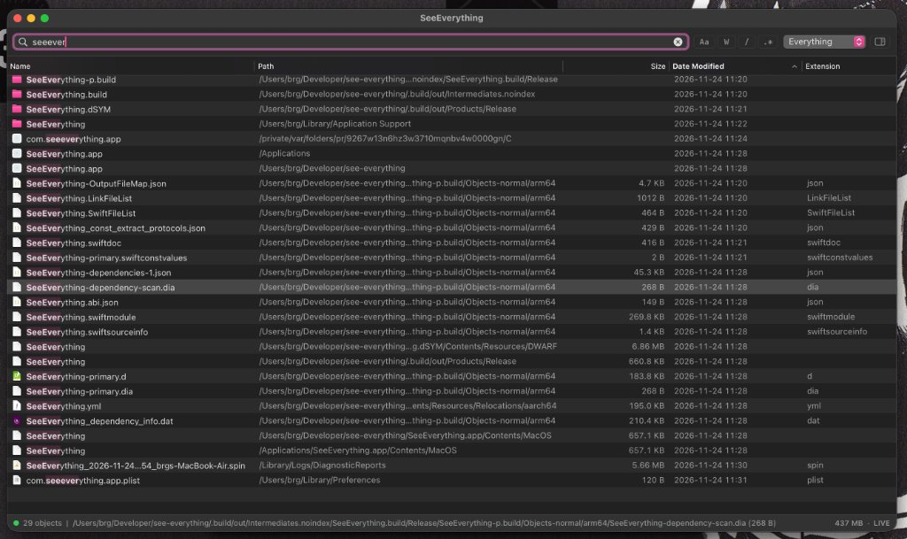

# SeeEverything

A native macOS port inspired by [Voidtools Everything](https://www.voidtools.com/) — instant, keystroke-by-keystroke file search across millions of files with zero Spotlight dependency.



## Why SeeEverything?

Spotlight is slow to update, skips developer/system/hidden directories, and struggles with substring or wildcard filename matching. **SeeEverything** indexes your filesystem directly into a compact in-memory database (written in C++20) paired with a native Swift/AppKit interface:

- **Parallel `getattrlistbulk()` APFS scanner** — indexes ~2.7M files in ~18 seconds on Apple Silicon without opening files or triggering iCloud (`SF_DATALESS`) downloads, while cleanly skipping APFS firmlink/virtual-volume duplicates.
- **Instant startup (~60 ms)** — saves the flat index to `~/Library/Application Support/SeeEverything/everything.db` and catches up on offline changes via persistent **`FSEvents`** event IDs.
- **Live real-time sync** — watches filesystem changes continuously with `FSEvents` so newly created, renamed, or deleted files appear automatically.
- **Millisecond search across millions of files** — parallel C++20 query evaluator, instant multi-column sorting, and a virtualized `NSTableView` with cached macOS icons and bolded match highlights.
- **Native macOS UX** — global `⌥Space` hotkey (no Accessibility permission required), Spacebar **Quick Look**, optional split Preview Pane (`⌥⌘P`), drag-and-drop to Finder/apps, and menu bar icon.

### Benchmarks (Apple M4, 2,730,491 indexed objects)

| Operation | Time |
| --- | --- |
| Cold full-disk scan (`/`) | `18.1 s` |
| Warm reload from persisted DB | `60 ms` |
| Substring query (`Everything.exe`) | `10.9 ms` |
| Extension + path query (`ext:swift;cpp see-everything/`) | `4.1 ms` |
| Size + extension query (`size:>10mb ext:dmg;exe;zip;iso`) | `3.4 ms` |

---

## Install

### Download Release
1. Download **`SeeEverything-v1.0.0-macos-arm64.zip`** from the [Releases](https://github.com/m-borg/see-everything/releases) page.
2. Unzip and drag `SeeEverything.app` to `/Applications`.
3. Because the app is ad-hoc signed (not notarized with a paid Apple Developer ID), if macOS Gatekeeper warns on first launch, run:
   ```bash
   xattr -dr com.apple.quarantine /Applications/SeeEverything.app
   ```
4. Launch **SeeEverything** and grant **Full Disk Access** in *System Settings → Privacy & Security → Full Disk Access* so it can index `~/Desktop`, `~/Documents`, `~/Downloads`, and protected locations, then click **Rescan**.

### Build from Source

Requires macOS 13+ and Xcode / Swift 6 toolchain:

```bash
git clone https://github.com/m-borg/see-everything.git
cd see-everything
./build-app.sh
open SeeEverything.app
```

A CLI search/benchmark binary (`see-cli`) is also built at `.build/out/Products/Release/see-cli`.

---

## Search Syntax

SeeEverything supports Voidtools Everything's search syntax:

| Syntax | Meaning |
| --- | --- |
| `foo bar` | **AND** — matches both `foo` and `bar` |
| `foo \| bar` | **OR** — matches either `foo` or `bar` |
| `!foo` | **NOT** — excludes `foo` |
| `"my file"` | Exact phrase with spaces |
| `<a \| b> c` | Grouping |
| `*.pdf`, `img_??` | Wildcards (`*` and `?`) |
| `Downloads/pdf` | Contains `/` → matches against full path |
| `ext:pdf;docx;txt` | Filter by semicolon-separated extensions |
| `file:` / `folder:` | Files only / Folders only |
| `size:>10mb` | Size comparison (`empty`, `tiny`…`gigantic`, `1mb..50mb`) |
| `dm:today` | Date modified (`today`, `yesterday`, `thisweek`, `thismonth`, `thisyear`, `last24hours`, `>2026-01-01`) |
| `dc:thisyear` | Date created |
| `parent:/Users/...` | Exact parent directory |
| `startwith:` / `endwith:` | Prefix / suffix match |
| `len:>40` / `depth:3` / `empty:` | Filename length / folder depth / empty files & folders |
| `case:` / `ww:` / `path:` / `regex:` | Per-term modifiers |

## Keyboard Shortcuts

| Shortcut | Action |
| --- | --- |
| `⌥Space` | Toggle SeeEverything window from anywhere |
| `⌘F` / `⌘L` | Focus search bar |
| `↓` | Jump from search bar into results |
| `Return` | Open selected item(s) |
| `⌘Return` | Reveal in Finder |
| `Space` | Quick Look preview |
| `⌥⌘P` | Toggle Preview Pane |
| `⌘C` / `⇧⌘C` | Copy file(s) / Copy full path(s) |
| `⌘⌫` | Move selected item(s) to Trash |
| `⌥⌘C` / `⌥⌘W` / `⌥⌘U` / `⌥⌘R` | Toggle Case / Whole Word / Path / Regex |
| `⌘R` | Force Rebuild Index |

## Architecture

- [`Sources/EverythingCore`](Sources/EverythingCore) — C++20 indexing & search engine (`Scanner.hpp`, `IndexStore.hpp`, `FSEventsWatcher.hpp`, `QueryEngine.hpp`, `Engine.cpp`) exposed via a C ABI ([`EverythingCore.h`](Sources/EverythingCore/include/EverythingCore.h)).
- [`Sources/SeeEverything`](Sources/SeeEverything) — Native Swift/AppKit application (`MainWindowController.swift`, `EngineBridge.swift`, `PreviewPaneView.swift`, `GlobalHotkey.swift`, `AppDelegate.swift`).
- [`Sources/SeeCLI`](Sources/SeeCLI) — Command-line search and benchmarking utility.

## License

MIT — see [LICENSE](LICENSE).
